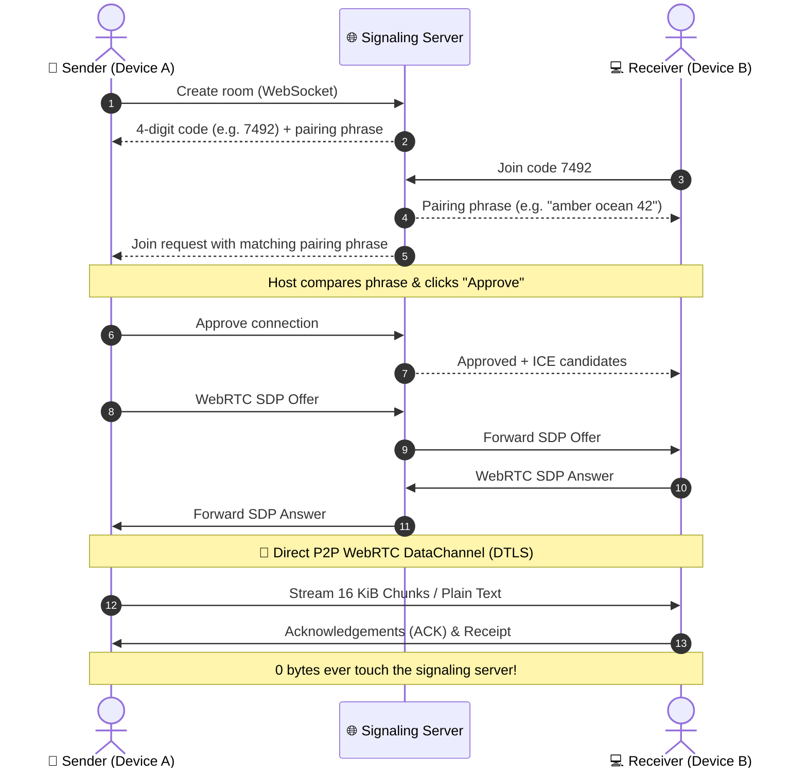

<p align="center">
  
</p>

<p align="center">
  <a href="https://vexuli.vercel.app/">
    
  </a>
</p>

<p align="center">
  <a href="https://vexuli.vercel.app/"></a>
  <a href="https://github.com/shivaa003/vexuli"></a>
  <a href="#-self-hosting--deployment"></a>
</p>

<p align="center">
  
  
  
  
  
  
  
</p>

<p align="center">
  <b><a href="#-transfer-workspace">Transfer</a></b> • 
  <b><a href="#-live-telemetry--analytics-dashboard">Live Analytics</a></b> • 
  <b><a href="#-dark--light-mode">Theme Mode</a></b> • 
  <b><a href="#-how-it-works">How it Works</a></b> • 
  <b><a href="#-privacy-plainly-stated">Privacy</a></b> • 
  <b><a href="#-faq">FAQ</a></b> • 
  <b><a href="#-self-hosting--deployment">Deploy Free</a></b>
</p>


## 📸 Live Preview

<p align="center">
  <a href="https://vexuli.vercel.app/">
    
  </a>
  <br/>
  <em>👆 Click the image to open Vexuli in real time</em>
</p>

---

## 📖 About Vexuli

> **Vexuli. From your device. To theirs. Directly.**
>
> Make a four-digit room, connect a second browser, and beam files or text in real time. The host verifies a pairing phrase and approves who joins. Content travels over an encrypted WebRTC data channel, **never through the signaling server and never stored on any disk.**

<table>
<tr>
<td width="50%">

### ✨ Why Vexuli?
- 🔢 One-time **4-digit room code** (auto-expires in 5 min)
- 🛡️ Host **verifies pairing phrase & approves** joiner
- 🔐 **WebRTC DTLS** encrypted peer-to-peer data channels
- 📊 **100% Real-Time Analytics Dashboard** (zero fake data)
- 🌓 **Dark & Light Mode** toggle with persistent storage
- 💾 **File System Access API** direct-to-disk streaming
- 🚫 **No account, zero cloud storage, zero telemetry snooping**

</td>
<td width="50%">

### 🎯 Built For
- 📱 Phone ↔️ Laptop instantaneous drops
- 💻 Two browsers, two screens, zero sign-ups
- ⚡ Quick files without cluttered Google Drive or Dropbox links
- 🔒 Sensitive documents & code diffs without leaving digital footprints
- 🌍 Cross-network transfers with STUN & optional TURN fallback
- 🛠️ Developers who want a 100% free, self-hostable transfer engine

</td>
</tr>
</table>

---

## ⚖️ Vexuli vs Traditional Cloud Uploads

| Feature |  | ☁️ Cloud Storage (Drive/Dropbox) | 💬 Chat Apps (Slack/WhatsApp) |
| :--- | :---: | :---: | :---: |
| **Account Required** | ❌ **None** | ✅ Mandatory | ✅ Mandatory |
| **Files Stored on Server** | ❌ **Never (0 Bytes)** | ⚠️ Permanent / Buckets | ⚠️ Cloud History |
| **Direct Browser-to-Browser** | ✅ **Yes (WebRTC P2P)** | ❌ Upload then Download | ❌ Proxy servers |
| **Host Approves Joiner** | ✅ **Verification Phrase** | ❌ Link = Open Access | ❌ Group Access |
| **Residual Links Left Behind** | ❌ **Destroyed on exit** | ⚠️ Lingering URLs | ⚠️ Chat logs |
| **Real-Time Analytics** | ✅ **Live Node Telemetry** | ❌ Opaque | ❌ Black box |
| **Dark & Light Theme** | ✅ **Seamless Toggle** | ⚠️ App dependent | ⚠️ App dependent |
| **Installation Needed** | ❌ **100% In-Browser** | ⚠️ Often Desktop app | ⚠️ App needed |

---

## ✨ Core Features

<table>
<tr>
<td align="center" width="33%">
<h1>🔢</h1>
<h3>4-Digit Room Code</h3>
<p>Generate a one-time random 4-digit code. Share it verbally or in text. Codes expire after 5 minutes.</p>
</td>
<td align="center" width="33%">
<h1>🔐</h1>
<h3>Encrypted WebRTC</h3>
<p>Data channels use DTLS 1.2/1.3 encryption. Only sender and receiver hold cryptographic session keys.</p>
</td>
<td align="center" width="33%">
<h1>🛡️</h1>
<h3>Pairing Phrase Approval</h3>
<p>Both devices display an identical 2-word phrase. The host must verify and manually approve the joiner.</p>
</td>
</tr>
<tr>
<td align="center" width="33%">
<h1>📁</h1>
<h3>Chunked File Streaming</h3>
<p>16 KiB backpressure-gated chunks with ACK flow control. Up to 100 MB per file, 20 files per queue.</p>
</td>
<td align="center" width="33%">
<h1>💾</h1>
<h3>Direct-to-Disk Save</h3>
<p>Uses Chromium File System Access API to stream chunks directly to disk. Automatic Blob fallback for Safari/Firefox.</p>
</td>
<td align="center" width="33%">
<h1>💬</h1>
<h3>Instant Text &amp; Clipboard</h3>
<p>Send text snippets, keys, or links up to 4,000 characters. Instant clipboard copy and delivery indicators.</p>
</td>
</tr>
<tr>
<td align="center" width="33%">
<h1>📊</h1>
<h3>Real Live Analytics</h3>
<p>Real-time SVG charts, active room counts, volume beamed, and device telemetry. Zero demo data.</p>
</td>
<td align="center" width="33%">
<h1>🌓</h1>
<h3>Dark &amp; Light Themes</h3>
<p>Smooth transitions between cyber dark (#04070d) and clean slate light (#f8fafc) with localStorage sync.</p>
</td>
<td align="center" width="33%">
<h1>🚀</h1>
<h3>1-Click Free Deploy</h3>
<p>Deploy on Render, Koyeb, or Railway in minutes. Includes ready-to-run WebSocket signaling server.</p>
</td>
</tr>
</table>

---

## 📊 Live Telemetry & Analytics Dashboard

Vexuli includes an embedded, interactive telemetry suite (`#analytics`) showing **overall platform usage across ALL users worldwide — past to up-to-date, in real time**. Zero mock data: every number is earned by genuine rooms, handshakes, transfers, and visits.

- **Active P2P Channels:** Live count of open rooms and connected devices right now.
- **Total Transfers (All Users):** All-time cumulative file + text transfers completed by everyone, with fast counting animations.
- **Global Volume Beamed:** All-time zero-knowledge bytes transmitted directly peer-to-peer.
- **Signals Relayed & Node Health:** All-time signaling messages plus live round-trip ping and process uptime.
- **Total Site Visits:** All-time visits counted once per browser session.
- **Interactive SVG Timeline:** Smooth cubic Bézier area chart with checkpoint tooltips over **24h**, **7d**, and **30d** windows. Switch between *Transfers*, *Signals & Handshakes*, and *Volume (Bytes)*.
- **Payload Distribution:** Real percentage breakdown between files and plain text payloads.
- **Device & Client Matrix:** Real breakdown of connecting platforms (Desktop, Mobile, Tablet).
- **Live Transfer Pulse:** Streaming feed of anonymous cryptographic and transfer events. **No room codes or filenames are ever exposed in public feeds.**

### How overall counts stay global (no mock data)

| Layer | What it does |
| :--- | :--- |
| 🖥️ **Node server** (`server/index.mjs`) | Persists real totals + 24h hourly history to `server/data/global-telemetry.json` |
| ☁️ **Serverless** (`api/*`) | Tracks live-window activity per Vercel instance |
| 🌍 **Shared global counters** | Both runtimes mirror cumulative totals into durable no-auth counters, merged with `max()` per metric — so Render, Vercel, and self-hosted nodes all contribute to **one overall past → up-to-date count** |
| 📊 **Dashboard** | Polls `/api/stats` every 3s (primary), falls back to shared counters + cached snapshot when offline |

Privacy: only aggregate numbers are stored (counts + byte sums). Never room codes, filenames, file bytes, message content, or IPs. Telemetry writes are rate-limited per IP, and automated tests run with `DISABLE_GLOBAL_SYNC=1` plus isolated telemetry files so they never pollute production analytics.

---

## 🌓 Dark / Light Mode

Toggle between two bespoke, accessibility-checked palettes:
- **Dark Mode (Default):** Deep midnight canvas (`#04070d`), glowing cyan/mint accents (`#35e4c1`), refined glassmorphism, and high-contrast text.
- **Light Mode:** Modern crisp slate canvas (`#f8fafc`), elevated pure-white cards with soft ambient shadows, deep slate typography (`#0f172a`), and teal highlights (`#0d9488`).
- **Zero-Flicker Init:** Uses an inline head script to prevent light/dark flashes on page load.
- **Persistent:** Remembers preference in `localStorage` under `vexuli_theme`.

---

## 🔄 How It Works

<table>
<tr>
<td align="center" width="33%">
<h1>01</h1>
<h3>🏠 Create a Room</h3>
<p>Click <b>Generate a 4-digit code</b> on Device A. The room waits in memory for 5 minutes with a unique number.</p>
</td>
<td align="center" width="33%">
<h1>02</h1>
<h3>🔗 Connect Device B</h3>
<p>Enter the code on Device B. Both devices compare an identical pairing phrase. Device A approves entry.</p>
</td>
<td align="center" width="33%">
<h1>03</h1>
<h3>📤 Beam Files &amp; Text</h3>
<p>Stream files or copy text in either direction. The receiver saves directly to disk. Once closed, the room vanishes.</p>
</td>
</tr>
</table>



---

## 🔒 Privacy, Plainly Stated

> **The server introduces you. It does not take your files.**

<p align="center">
  
  
  
  
</p>

### What goes where

<table>
<tr>
<th width="33%">🌐 Signaling Server</th>
<th width="33%">↔️ Between the Browsers</th>
<th width="33%">💻 On Your Device</th>
</tr>
<tr>
<td>Temporary 4-digit room code, browser label, and SDP/ICE connection signals. Rooms live exclusively in volatile RAM and dissolve the instant peers disconnect.</td>
<td>Encrypted binary chunks and UTF-8 text travel peer-to-peer over WebRTC data channels with DTLS encryption. If direct connection fails, a TURN relay forwards encrypted packets in transit without saving them.</td>
<td>The recipient chooses whether to accept each file. Supported browsers stream chunks directly to disk via the File System Access API. Completed downloads are kept locally in page memory.</td>
</tr>
</table>

> ⚠️ **Notice:** While payload content is end-to-end encrypted and never stored, network routing metadata (IP addresses) is visible to peers and network providers. Vexuli is a direct transfer utility, not a network anonymity service (like Tor).

---

## ❓ FAQ

<details>
<summary><b>01 — Does Vexuli upload or store my files?</b></summary>
<br/>
<b>No.</b> Files and text travel directly between the two browsers over an encrypted WebRTC connection. The signaling server only brokers the initial handshake and never receives, inspects, or writes file bytes to disk.
</details>

<details>
<summary><b>02 — Is a four-digit code enough to keep a transfer private?</b></summary>
<br/>
The 4-digit code is an ephemeral rendezvous address, not an encryption key. Codes expire in 5 minutes, brute-force attempts trigger strict IP lockouts (max 5 tries/minute), both devices verify an identical pairing phrase, and the host must manually click <b>Approve</b>. WebRTC DTLS encrypts the actual transfer channel.
</details>

<details>
<summary><b>03 — Does this work across different networks, Wi-Fi &amp; mobile data?</b></summary>
<br/>
<b>Yes.</b> On most networks, WebRTC establishes direct peer-to-peer connectivity via STUN. For symmetric NATs or restrictive corporate firewalls, Vexuli seamlessly supports TURN relaying (e.g., via Coturn or Metered.ca) where encrypted packets are forwarded without storage.
</details>

<details>
<summary><b>04 — What is the file transfer limit?</b></summary>
<br/>
Up to <b>100 MB per file</b> and <b>20 files per queue</b>. This ensures browser memory remains completely safe even on mobile Safari and Firefox (which use Blob reassembly), while Chromium browsers stream chunks directly to disk without memory limits. Text messages can be up to 4,000 characters.
</details>

<details>
<summary><b>05 — What happens if I close the tab mid-transfer?</b></summary>
<br/>
The WebRTC channel closes and active transfers halt immediately. Once closed, the room code is destroyed and cannot be rejoined. Completed downloads remain safe in your browser until you navigate away or close the page.
</details>

<details>
<summary><b>06 — Can both devices send and receive at the same time?</b></summary>
<br/>
<b>Yes.</b> Once the secure channel is established, communication is fully bidirectional. Both devices can send text messages, drop files, and accept incoming payloads simultaneously.
</details>

---

## 🛠️ Tech Stack

<p align="center">
  
</p>

| Component | Technology | Purpose |
| :--- | :--- | :--- |
| 🎨 **Frontend UI** | **React 19, TypeScript, Tailwind CSS v4** | Modern responsive landing page, transfer workspace, and telemetry dashboard |
| ⚡ **Build Tool** | **Vite 7, vite-plugin-singlefile** | Ultra-fast HMR and production bundling |
| 🔐 **Transfer Layer** | **WebRTC DataChannel (RTCDataChannel)** | P2P binary chunk streaming, SCTP backpressure, and DTLS 1.2/1.3 encryption |
| 🌐 **Signaling Server** | **Node.js, `ws` (WebSocket)** | In-memory room management, 4-digit codes, rate-limiting, and ICE/SDP exchange |
| 💾 **Storage API** | **File System Access API (`showSaveFilePicker`)** | Direct streaming writes to local disk with Blob fallback |
| 🧪 **Testing** | **Playwright & Node Test Runner (`node:test`)** | Automated headless browser WebRTC transfer tests & signaling unit tests |

---

## 🚀 Self-Hosting & Deployment

Vexuli can be self-hosted on any Node.js host supporting WebSockets (Render, Koyeb, Railway, Fly.io, or any $5 VPS) with **zero ongoing maintenance costs**.

### Option 1: 1-Click Free Hosting on Render.com

1. Fork or push this repository to your GitHub account: `https://github.com/shivaa003/vexuli`.
2. Log into [Render.com](https://render.com) and click **New +** → **Web Service**.
3. Select your GitHub repository.
4. Render will automatically read the included `render.yaml` blueprint:
   - **Environment:** `Node`
   - **Build Command:** `npm ci && npm run build`
   - **Start Command:** `npm start`
   - **Health Check Path:** `/health`
   - **Plan:** Free
5. Click **Create Web Service**. You will receive an instant `https://your-app.onrender.com` URL with free automated SSL and WebSocket support!

### Option 2: Run with Docker or Any VPS

```bash
# Clone the repository
git clone https://github.com/shivaa003/vexuli.git
cd vexuli

# Install dependencies and build
npm ci
npm run build

# Start production server
PORT=3000 NODE_ENV=production npm start
```

### Option 3: (Optional) Adding a Free TURN Relay

Direct connections work automatically across standard Wi-Fi networks. For strict mobile data carriers (4G/5G) or restrictive corporate firewalls, add TURN credentials:
1. Get free TURN credentials from [metered.ca/stun-turn](https://www.metered.ca/stun-turn) (500 MB free per month) or run your own [coturn](https://github.com/coturn/coturn).
2. Set these environment variables in your host:
   ```env
   TURN_URLS=turn:a.relay.metered.ca:443?transport=tcp
   TURN_SHARED_SECRET=your_metered_secret_here
   ```

---

## 💻 Local Development

```bash
# 1. Clone the project
git clone https://github.com/shivaa003/vexuli.git
cd vexuli

# 2. Install dependencies
npm ci

# 3. Start development server (serves frontend and WebSocket signaling on port 5173)
npm run dev

# 4. Open in two browser tabs or devices
# Tab 1 (Host): Click "Generate a 4-digit code"
# Tab 2 (Guest): Click "I have a code" and enter the 4 digits
```

### Running Automated Verification Tests

```bash
# Type check TypeScript
npm run typecheck

# Run server signaling unit tests (rate-limits, room codes, approval)
npm test

# Run full end-to-end browser tests using Playwright (WebRTC text & binary file transfer)
npm run test:e2e
```

---

## 👨‍💻 Author

<p align="center">
  
  <h3>Shiva</h3>
  <p><b>Building private, direct web tools — no detours.</b></p>
  <a href="https://github.com/shivaa003"></a>
  <a href="https://vexuli.vercel.app/"></a>
</p>

<p align="center">
  
  
</p>

---

## 📄 License

This project is licensed under the **MIT License** — see the [LICENSE](LICENSE) file for details.

---

## ⭐ Show Your Support

<p align="center">
  <b>Ready when you are.</b> The file can be on the other screen in a moment.<br/>
  Both people open Vexuli. One makes a room. The other joins. Nothing to install.
  <br/><br/>
  <a href="https://vexuli.vercel.app/"></a>
  <a href="https://github.com/shivaa003/vexuli"></a>
</p>

<p align="center">
  
</p>

<p align="center">Made with ❤️ by <b>Shiva</b> • © 2026 Vexuli • From your device. To theirs. Directly.</p>
