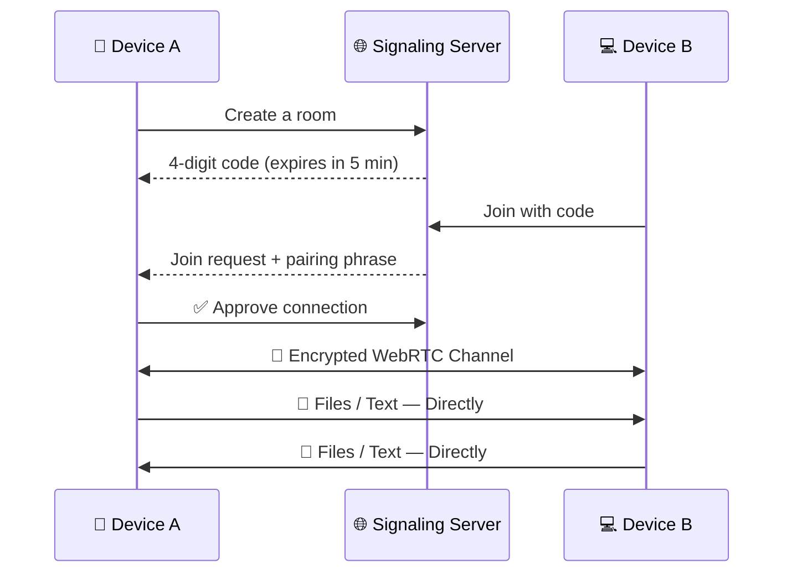

<p align="center">
  
</p>

<p align="center">
  <a href="https://vexuli.vercel.app/">
    
  </a>
</p>

<p align="center">
  <a href="https://vexuli.vercel.app/"></a>
  <a href="https://github.com/shivaa003/vexuli"></a>
</p>

<p align="center">
  
  
  
  
  
</p>

<p align="center">
  <b><a href="https://vexuli.vercel.app/">Transfer</a></b> • 
  <b><a href="#-how-it-works">How it Works</a></b> • 
  <b><a href="#-privacy-plainly-stated">Privacy</a></b> • 
  <b><a href="#-good-to-know">FAQ</a></b> • 
  <b><a href="#-getting-started">Getting Started</a></b>
</p>


## 📸 Live Preview

<p align="center">
  <a href="https://vexuli.vercel.app/">
    
  </a>
  <br/>
  <em>👆 Click the image to try Vexuli live</em>
</p>

## 📖 About Vexuli

> **Vexuli. From your device. To theirs. Directly.**
>
> Make a four-digit room, connect a second browser and send files or text in real time. You approve who joins. Your content travels over an encrypted WebRTC connection, **never through our signaling server.**

<table>
<tr>
<td width="50%">

### ✨ Why Vexuli?
- 🔢 One-time **4-digit room code**
- ⏱️ Code expires in **5 minutes**
- 🔐 **WebRTC DTLS** encrypted transfer
- 👤 You **approve** who joins
- 🚫 No account, no upload, no storage

</td>
<td width="50%">

### 🎯 Built For
- 📱 Phone ↔️ Laptop transfers
- 💻 Two browsers, two screens
- ⚡ Quick files without cloud drives
- 🔒 Private sharing without sign-ups
- 🌍 Different networks & countries

</td>
</tr>
</table>

## ⚖️ Vexuli vs Cloud Uploads

| Feature |  | ☁️ Cloud Services |
| :--- | :---: | :---: |
| Account Required | ❌ No | ✅ Yes |
| Files Stored on Server | ❌ Never | ✅ Yes |
| Direct Device-to-Device | ✅ Yes | ❌ No |
| Host Approves Joiner | ✅ Yes | ❌ Link = Access |
| Download Link Left Behind | ❌ No | ✅ Yes |
| Installation Needed | ❌ No | ⚠️ Sometimes |

## ✨ Features

<table>
<tr>
<td align="center" width="33%">
<h1>🔢</h1>
<h3>4-Digit Room</h3>
<p>Generate a one-time code, share it, and connect in seconds. It expires in 5 minutes.</p>
</td>
<td align="center" width="33%">
<h1>🔐</h1>
<h3>Encrypted WebRTC</h3>
<p>Files & text travel browser-to-browser over a DTLS-encrypted WebRTC data channel.</p>
</td>
<td align="center" width="33%">
<h1>✅</h1>
<h3>You Approve Entry</h3>
<p>Compare the pairing phrase and approve the request. No approval, no connection.</p>
</td>
</tr>
<tr>
<td align="center" width="33%">
<h1>📁</h1>
<h3>Files + Text</h3>
<p>Drop files or send plain text in either direction, in real time.</p>
</td>
<td align="center" width="33%">
<h1>🙅</h1>
<h3>No Account, No Upload</h3>
<p>No sign-up on either side. Nothing is uploaded or stored on a server.</p>
</td>
<td align="center" width="33%">
<h1>💾</h1>
<h3>Recipient Accepts</h3>
<p>The receiver accepts each file and saves it locally. Never a server-side link.</p>
</td>
</tr>
</table>

## 🔄 How It Works

<table>
<tr>
<td align="center" width="33%">
<h1>01</h1>
<h3>🏠 Create a Room</h3>
<p>Open Vexuli on one device and generate a unique four-digit code. It waits for 5 minutes, then it's retired.</p>
</td>
<td align="center" width="33%">
<h1>02</h1>
<h3>🔗 Connect Device 2</h3>
<p>Enter the code on a second browser. Compare the pairing phrase, then approve on the first device.</p>
</td>
<td align="center" width="33%">
<h1>03</h1>
<h3>📤 Send It</h3>
<p>Drop files or send text in either direction. The recipient accepts each file and saves it locally.</p>
</td>
</tr>
</table>



## 🔒 Privacy, Plainly Stated

> **The server introduces you. It does not take your files.**

<p align="center">
  
  
  
</p>

### What goes where

<table>
<tr>
<th width="33%">🌐 Signaling Server</th>
<th width="33%">↔️ Between the Browsers</th>
<th width="33%">💻 On Your Device</th>
</tr>
<tr>
<td>Temporary room code, browser label and connection details. Rooms live in memory and are removed when the session ends.</td>
<td>File bytes and text over a WebRTC data channel encrypted with DTLS. A configured TURN server may relay encrypted packets in transit.</td>
<td>The recipient chooses whether to accept a file. It is saved locally or offered as a browser download, never as a server-side link.</td>
</tr>
</table>

> ⚠️ **Important:** The other peer and network providers may still see your IP address and connection metadata. Vexuli is **not** an anonymity service.

## ❓ Good to Know

<details>
<summary><b>01 — Does Vexuli upload or store my files?</b></summary>
<br/>No. Files and text travel directly between the two browsers over an encrypted WebRTC connection. The signaling server only helps browsers find each other and never receives or retains your content.
</details>

<details>
<summary><b>02 — Is a four-digit code enough to keep a transfer private?</b></summary>
<br/>The code is only the first step. It's one-time, expires in 5 minutes, you compare a pairing phrase, and the host must manually approve the join request. The transfer itself is DTLS-encrypted.
</details>

<details>
<summary><b>03 — Does this work on different networks and in different countries?</b></summary>
<br/>Yes. WebRTC is designed for this, and where a direct connection isn't possible, a TURN server can relay the still-encrypted packets between browsers.
</details>

<details>
<summary><b>04 — How large a file can I send?</b></summary>
<br/>There's no server-side upload limit because nothing is uploaded. Practical limits depend on your browser, device memory, and connection quality.
</details>

<details>
<summary><b>05 — What if I close the page during a transfer?</b></summary>
<br/>The session ends and ongoing transfers stop. Completed downloads remain available until you start a new session or close the page.
</details>

<details>
<summary><b>06 — Can both devices send files and text?</b></summary>
<br/>Yes. Once connected, the transfer is fully two-way — both devices can send and receive.
</details>

## 🛠️ Tech Stack

<p align="center">
  
</p>

<p align="center">
  
  
  
  
</p>

| Layer | What it does |
| :--- | :--- |
| 🎨 **Frontend** | Browser UI, room codes, file & text handling |
| 🔐 **WebRTC** | Encrypted peer-to-peer data channel |
| 🌐 **Signaling Server** | Creates rooms, connects browsers — in memory only |
| 🔄 **TURN (when needed)** | Relays *encrypted* packets when direct connection fails |

## 🚀 Getting Started

<details>
<summary><b>Click to expand installation steps</b></summary>

### 1. Clone the repository
```bash
git clone https://github.com/shivaa003/vexuli.git
```

### 2. Go to the project folder
```bash
cd vexuli
```

### 3. Install dependencies
```bash
npm install
```

### 4. Run locally
```bash
npm run dev
```

### 5. Open & test with two browsers
```
http://localhost:3000
```
Create a room in one browser, then join with the code in a second browser or device.

</details>

## 👨‍💻 Author

<p align="center">
  
  <h3>Shiva</h3>
  <p>Building private, direct web tools — no detours.</p>
  <a href="https://github.com/shivaa003"></a>
  <a href="https://vexuli.vercel.app/"></a>
</p>

<p align="center">
  
  
</p>

## 📄 License

This project is licensed under the **MIT License**.

## ⭐ Show Your Support

<p align="center">
  <b>Ready when you are.</b> The file can be on the other screen in a moment.<br/>
  Both people open Vexuli. One makes a room. The other joins. Nothing to install.
  <br/><br/>
  <a href="https://vexuli.vercel.app/"></a>
  <a href="https://github.com/shivaa003/vexuli"></a>
</p>

<p align="center">
  
</p>
<p align="center">Made with ❤️ by <b>Shiva</b> • © 2025 Vexuli • From your device. To theirs. Directly.</p>
